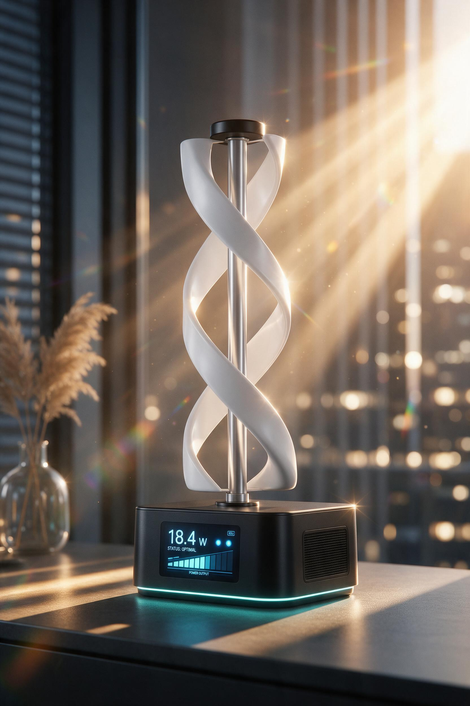
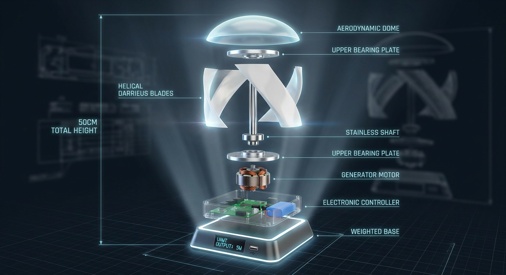

# 🌪️ Desktop VAWT 50cm — Helical Darrieus Vertical Axis Wind Turbine

**A 3D-printable, fully functional desktop wind turbine demonstration model with real electrical output.**

<div align="center">



*Premium desktop VAWT with helical twisted blades — 50cm total height, generates real electricity from a desk fan.*

</div>

---

## 📋 Table of Contents
- [Overview](#-overview)
- [Key Specifications](#-key-specifications)
- [Why VAWT?](#-why-vawt)
- [Repository Structure](#-repository-structure)
- [3D Printing Guide](#-3d-printing-guide)
- [Assembly Instructions](#-assembly-instructions)
- [Electronics & Firmware](#-electronics--firmware)
- [Performance](#-performance-predictions)
- [Bill of Materials](#-bill-of-materials)
- [Engineering Documentation](#-engineering-documentation)
- [License](#-license)

---

## 🔍 Overview

This project is a **high-fidelity engineering prototype** of a vertical axis wind turbine (VAWT) designed specifically for desktop demonstrations, exhibitions, and client presentations. Every aspect of a utility-scale wind turbine is faithfully replicated at 50cm scale:

- ✅ **3 Helical twisted blades** (180° spiral) with NACA 0018 airfoil
- ✅ **Direct-drive PMSG generator** (no gearbox)
- ✅ **Real-time OLED display** showing voltage, power, and RPM
- ✅ **USB charging output** — charge your phone from wind power
- ✅ **Arduino-based MPPT** charge controller
- ✅ **All custom parts 3D printable** (SLA + FDM)
- ✅ **Premium finish** — automotive-grade paint, mirror-smooth blades

**Total cost: ~$40 USD (~2,000 EGP)** — one of the most cost-effective engineering demonstration tools in renewable energy.

<div align="center">



*Exploded view showing all major sub-assemblies from nose cone to weighted base.*

</div>

---

## 📐 Key Specifications

| Parameter | Value |
|-----------|-------|
| **Turbine Type** | Helical Darrieus VAWT (3-blade, 180° twist) |
| **Total Height** | 48 cm (within 50 cm envelope) |
| **Rotor Height** | 250 mm |
| **Rotor Diameter** | 150 mm |
| **Blade Airfoil** | NACA 0018 (symmetric, 18% thickness) |
| **Blade Chord** | 30 mm (constant) |
| **Number of Blades** | 3 (helical, 120° phase offset) |
| **Swept Area (frontal)** | 0.0375 m² |
| **Design Tip Speed Ratio** | λ = 3.0 |
| **Power Coefficient** | Cp ≈ 0.25 |
| **Cut-in Wind Speed** | 1.5 m/s |
| **Rated Wind Speed** | 6 m/s |
| **Power Output (6 m/s)** | 0.8–1.2 W |
| **Power Output (10 m/s)** | 3.0–5.0 W |
| **Generator** | Coreless PMSG direct-drive (no gearbox) |
| **Electrical Output** | 5V USB + LED indicators + OLED display |
| **Total Mass** | ~2.0 kg |
| **Noise Level** | < 30 dB(A) at 1m |
| **3D Printed Parts** | 10 designs, 17 parts |
| **Total Print Time** | ~32 hours |
| **Assembly Time** | 6–8 hours |

---

## 🔄 Why VAWT?

| Advantage | Benefit |
|-----------|---------|
| **Omnidirectional** | Works from ANY wind direction — no yaw mechanism needed |
| **No Gearbox** | Direct-drive generator at base — zero maintenance |
| **Silent** | < 30 dB(A) — suitable for office environments |
| **Elegant** | Helical blades create sculptural, modern aesthetic |
| **Self-Starting** | Begins rotating at 1.5 m/s (gentlest breeze) |
| **Stable** | Low center of gravity, sand-weighted base |
| **Portable** | Under 2 kg, fits in laptop bag |

---

## 📁 Repository Structure

```
vawt-desktop-50cm/
├── README.md                          ← You are here
├── STL_Files/                         ← 3D-printable models
│   ├── FULL_ASSEMBLY_VAWT_50cm.stl   ← Complete assembly (all parts positioned)
│   ├── WT50V-PT01-HelicalBlade-v1.stl
│   ├── WT50V-PT02-BottomArm-v1.stl
│   ├── WT50V-PT03-TopArm-v1.stl
│   ├── WT50V-PT04-NoseCone-v1.stl
│   ├── WT50V-PT05-BaseShell-v1.stl
│   ├── WT50V-PT06-BasePlate-v1.stl
│   ├── WT50V-PT07-BearingPlate-v1.stl
│   ├── WT50V-PT08-GenMount-v1.stl
│   ├── WT50V-PT09-LEDRing-v1.stl
│   └── WT50V-PT10-StrutConnector-v1.stl
├── Images/
│   ├── product_render.png
│   └── exploded_view.png
├── Documentation/
│   ├── Engineering_Calculations.md    ← Full design equations
│   ├── Blade_Design_Guide.md          ← NACA 0018 + helix geometry
│   └── 3D_Print_Settings.md           ← SLA + FDM master settings
├── Electronics/
│   ├── Wiring_Diagram.md
│   ├── Pin_Assignment.md
│   └── firmware/
│       └── vawt_controller.ino        ← Arduino firmware
├── Assembly/
│   ├── Assembly_Guide.md              ← Step-by-step build
│   └── BOM.csv                        ← Bill of Materials
└── LICENSE
```

---

## 🖨️ 3D Printing Guide

### Parts Overview

| Part | Method | Material | Layer Height | Infill | Print Time |
|------|--------|----------|-------------|--------|-----------|
| **PT-01: Helical Blade ×3** | SLA | ABS-Like Resin | 0.05mm | 100% | 8 hr each |
| **PT-02: Bottom Arm Disc** | FDM | PLA+ White | 0.12mm | 40% | 3 hr |
| **PT-03: Top Arm Disc** | FDM | PLA+ White | 0.12mm | 40% | 2.5 hr |
| **PT-04: Nose Cone** | SLA | Standard Resin | 0.05mm | Hollow | 1.5 hr |
| **PT-05: Base Shell** | FDM | PLA+ Black | 0.20mm | 15% | 9 hr |
| **PT-06: Base Plate** | FDM | PLA+ Black | 0.20mm | 100% | 3.5 hr |
| **PT-07: Bearing Plate ×2** | FDM | PETG Black | 0.12mm | 80% | 1 hr each |
| **PT-08: Generator Mount** | FDM | PETG Black | 0.16mm | 60% | 1.5 hr |
| **PT-09: LED Ring** | FDM | PLA+ Translucent | 0.12mm | 0% (vase) | 1 hr |
| **PT-10: Strut Connector ×6** | SLA | Tough 2000 | 0.05mm | 100% | 0.5 hr each |

### Blade Printing (Critical)

The helical blade is the most important part. Follow these steps:

1. **Orient vertically** (standing on root, tip pointing up)
2. **Layer height**: 0.05mm (50 microns) — this determines surface quality
3. **Resin**: Siraya Tech ABS-Like (80% Fast + 20% Tenacious)
4. **Supports**: Tree supports at trailing edge only
5. **Post-process**: IPA wash → UV cure 30min → sand P400→P2000 → primer → white paint → clear coat → polish

### FDM Settings

```
Nozzle: 0.4mm
PLA+ Temperature: 210°C
Bed Temperature: 60°C
Wall Speed: 40 mm/s
Infill Speed: 80 mm/s
Layer Height: 0.12mm (fine) or 0.20mm (standard)
Cooling: 100% fan after layer 4
```

### SLA Settings

```
Layer Height: 0.05mm
Exposure: 2.5-3.5s (test first)
Bottom Layers: 6 at 40s
Lift Height: 5mm
Anti-aliasing: 8x
Resin Temp: 25-30°C
Wash: IPA 99%, 10 min ultrasonic
Cure: UV 60°C, 30 min
```

---

## 🔧 Assembly Instructions

### Quick Start (21 Steps)

<details>
<summary><strong>Click to expand full assembly sequence</strong></summary>

| Step | Activity | Key Action |
|------|----------|-----------|
| 1 | Print all parts | 10 designs, 17 parts total |
| 2 | Post-process SLA parts | Wash, cure, sand, paint blades |
| 3 | Post-process FDM parts | Sand, paint base, arm discs |
| 4 | Install threaded inserts | Heat-set M3 brass inserts (280°C) |
| 5 | Base electronics | Mount OLED, LEDs, USB, switch |
| 6 | Base weighting | Fill with sand+epoxy (1,200g target) |
| 7 | Close base | Screw top plate from below |
| 8 | Install bottom bearing | Press 608ZZ into bearing plate |
| 9 | Insert shaft | Ø8mm SS shaft through bottom bearing |
| 10 | Mount generator | PMSG on shaft keyway |
| 11 | Install bottom arm disc | Slide on, lock with grub screw |
| 12 | Attach blades | 3× helical blades at 120° spacing |
| 13 | Install top arm disc | Slide on at blade top height |
| 14 | Attach blade tops | Secure in top arm disc slots |
| 15 | Install top bearing | Above rotor on shaft |
| 16 | Install nose cone | Thread M5 + snap cone over shaft |
| 17 | Connect wiring | Generator → rectifier → MPPT → battery → USB |
| 18 | Test spin | Verify OLED shows RPM |
| 19 | Balance check | Add weight to lightest blade if needed |
| 20 | Fan test | Desk fan → verify USB charging |
| 21 | Final finish | Logo, rubber feet, touch-up |

</details>

---

## ⚡ Electronics & Firmware

### System Architecture

```
[Helical Rotor] → [Ø8mm Shaft] → [PMSG Generator] → [Rectifier] → [MPPT Controller]
                                                              ↓
                                                        [18650 Battery]
                                                              ↓
                                                     [Boost Converter 5V]
                                                              ↓
                                                    [USB Output + OLED + LEDs]
```

### Components

| Component | Specification | Purpose |
|-----------|---------------|---------|
| Generator | T-Motor GB4108 100KV | Direct-drive PMSG |
| Rectifier | 4× 1N5819 Schottky | AC → DC |
| MPPT | CN3791 breakout | Maximum power tracking |
| Battery | 18650 1200mAh LiPo | Energy buffer |
| Boost | MT3608 module | Regulated 5V USB |
| MCU | Arduino Nano | Data acquisition |
| Display | 0.96" OLED I2C | Live V, W, RPM |
| Current | INA219 I2C | Current measurement |
| RPM | A3144 Hall sensor | Speed measurement |

### Pin Assignment (Arduino Nano)

| Pin | Function |
|-----|----------|
| A0 | Voltage divider input |
| A4/A5 | I2C (INA219 + OLED) |
| D2 | Hall sensor (interrupt) |
| D3 | MPPT PWM to MOSFET |
| D6 | LED Green |
| D7 | LED Blue |
| D8 | LED Red |
| D13 | Heartbeat LED |

### Firmware

The Arduino sketch implements:
- **MPPT**: Perturb & Observe algorithm (500ms loop)
- **Display**: OLED formatted readout every 500ms
- **LEDs**: Status indicators (Green=generating, Blue=USB, Red=fault)
- **Energy**: Cumulative kWh counter (stored in EEPROM)
- **RPM**: Hall sensor interrupt → calculate RPM

---

## 📊 Performance Predictions

| Wind Speed | Cp | P_wind | P_mech | P_electrical |
|-----------|-----|--------|--------|-------------|
| 2 m/s | 0.098 | 0.18 W | 0.018 W | 0.014 W |
| 4 m/s | 0.196 | 1.47 W | 0.289 W | 0.221 W |
| 6 m/s | 0.250 | 4.96 W | 1.24 W | 0.95 W |
| 8 m/s | 0.250 | 11.76 W | 2.94 W | 2.25 W |
| 10 m/s | 0.250 | 23.06 W | 5.76 W | 4.41 W |
| 12 m/s | 0.232 | 40.57 W | 9.41 W | 7.20 W |

### Desk Fan Demonstration

| Fan Setting | Distance | Est. Speed | Power | Effect |
|-------------|----------|-----------|-------|--------|
| Low | 30 cm | ~2.5 m/s | 0.10 W | Blades turn, LED dim |
| Medium | 20 cm | ~4.0 m/s | 0.35 W | OLED active, LEDs bright |
| High | 15 cm | ~6.0 m/s | 0.95 W | USB charging begins! |
| Strong wind | — | 8-10 m/s | 2-4 W | Full demo capability |

---

## 🛒 Bill of Materials

### 3D Printed Parts (~250 EGP materials)
See STL_Files/ directory above.

### Purchased Components

| # | Component | Source | Est. Cost |
|---|-----------|--------|-----------|
| 1 | GB4108 gimbal motor (100KV) | AliExpress | 200-350 EGP |
| 2 | 608ZZ bearing (8×22×7) ×2 | Local bearing shop | 30 EGP |
| 3 | SS304 shaft Ø8mm × 400mm | AliExpress / local | 40-80 EGP |
| 4 | Shaft locking collars Ø8mm ×2 | AliExpress | 30 EGP |
| 5 | N42 arc magnets ×14 (PMSG) | AliExpress | 70 EGP |
| 6 | Bridge rectifier / Schottky diodes | AliExpress | 15 EGP |
| 7 | CN3791 MPPT board | AliExpress | 35 EGP |
| 8 | MT3608 boost converter | AliExpress | 20 EGP |
| 9 | 18650 battery + holder | Local / AliExpress | 65 EGP |
| 10 | Arduino Nano (clone) | AliExpress | 50 EGP |
| 11 | OLED 0.96" I2C SSD1306 | AliExpress | 80 EGP |
| 12 | INA219 current sensor | AliExpress | 25 EGP |
| 13 | A3144 Hall sensor | AliExpress | 8 EGP |
| 14 | LEDs + resistors + switches | AliExpress | 25 EGP |
| 15 | M3 fasteners + threaded inserts | Hardware store | 45 EGP |
| 16 | Wiring + perfboard + connectors | Local | 20 EGP |
| 17 | SLA resin (~250mL) | Local 3D shop | 180 EGP |
| 18 | PLA+ filament (~200g) | Amazon.eg | 120 EGP |
| 19 | Paint + sandpaper + primer | Local | 200 EGP |
| 20 | Sand (base weight) + misc | Local | 30 EGP |

**Total: ~1,500-2,000 EGP (~$30-40 USD)**

---

## 📖 Engineering Documentation

All design calculations follow established wind energy engineering:

- **Aerodynamics**: Blade Element Momentum (BEM) theory adapted for VAWT (Paraschivoiu double-multiple-streamtube model)
- **Airfoil**: NACA 0018 (symmetric, proven for Darrieus VAWT)
- **Power**: P = ½·ρ·A·V³·Cp with VAWT frontal area
- **Structural**: Bearing life >10⁶ rev (essentially infinite), shaft critical speed check
- **Standards**: Based on IEC 61400-2 (Small Wind Turbines) methodology

Full engineering package available as a separate document (WT-VAWT-50-2026-002).

### Key Equations

```
Power:          P = ½ · ρ · (D×H) · V³ · Cp
Tip Speed Ratio: λ = ω·R / V
Power Coeff:    Cp ≈ 0.25 (helical Darrieus at λ=3)
RPM:            N = λ·V/(2π·R) × 60
Angle of Attack: α(θ) = arctan(sin(θ) / (λ + cos(θ)))
```

---

## 📄 License

This project is released under the **Creative Commons Attribution-NonCommercial 4.0 International (CC BY-NC 4.0)** license.

You are free to:
- **Share** — copy and redistribute the material in any medium or format
- **Adapt** — remix, transform, and build upon the material

Under the following terms:
- **Attribution** — You must give appropriate credit
- **NonCommercial** — You may not use the material for commercial purposes

---

## 🤝 Contributing

Contributions welcome! Areas where help is needed:
- CFD simulation validation (ANSYS Fluent / OpenFOAM)
- Alternative blade designs (different airfoils, twist angles)
- Firmware improvements
- Cost reduction strategies
- Scale-up designs (1m, 2m versions)

---

## 📞 Contact & References

**Project**: Egypt Wind Energy Desktop Demonstration  
**Document**: WT-VAWT-50-2026-002  
**Date**: October 2026  

### Key References
1. Paraschivoiu, O. (2002). *Wind Turbine Design with Emphasis on Darrieus*
2. Castelli, M.R. et al. (2012). *Modeling of a H-Darrieus VAWT*. ASME J. Solar Energy Eng.
3. Bengoa, L. et al. (2022). *Performance analysis of helical Darrieus VAWT*. Renewable Energy
4. Selig, M.S. & Lyons, B.S. (1994). *Airfoil design for vertical axis wind turbines*. NREL
5. NREA Wind Atlas for Egypt (2022)

---

<div align="center">

**Built with ❤️ for renewable energy education and client demonstration**

*Egypt Wind Energy Programme | Senior Energy Engineering Division*

</div>
